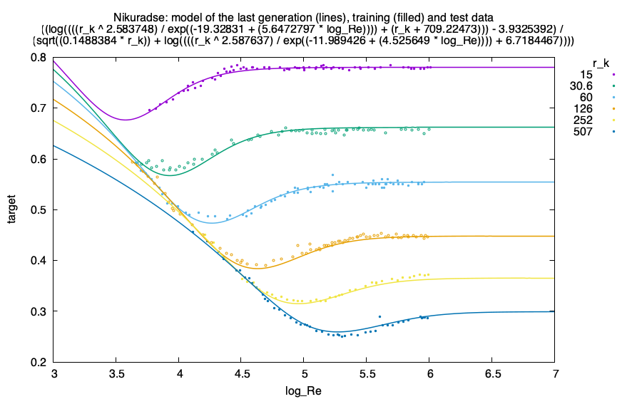
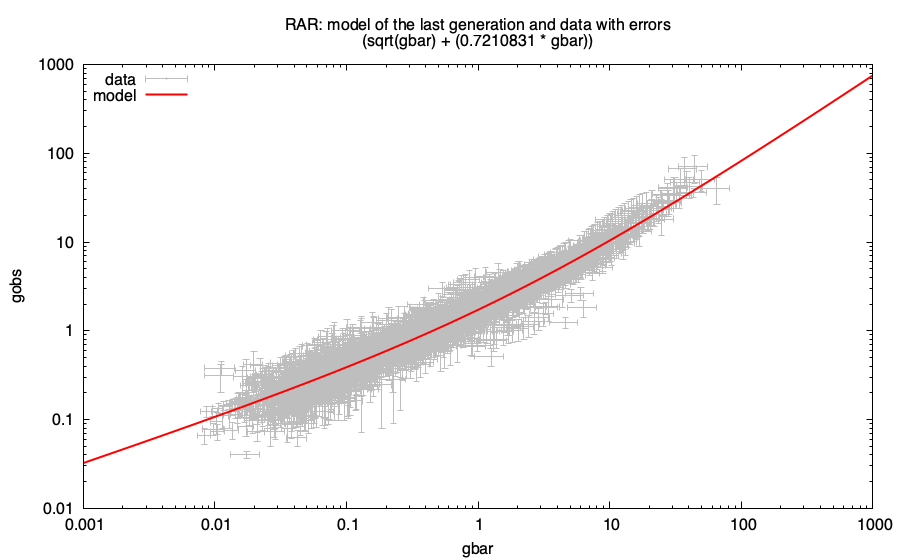
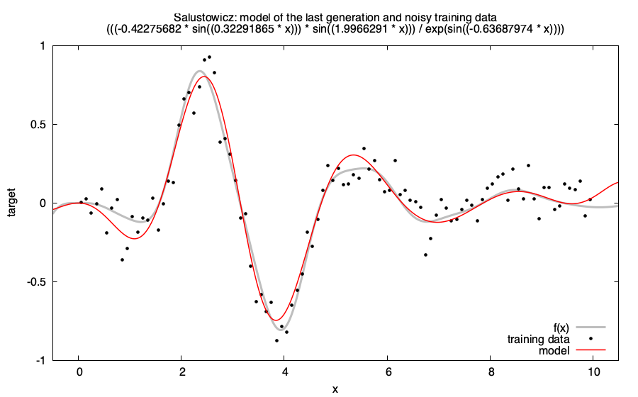

# NeoGP quickstart

This guide runs NeoGP on three datasets that are in [`examples/data/`](examples/data/):

| Dataset | Data | Model |
|---|---|---|
| Nikuradse (`nikuradse_1_train.csv`, `nikuradse_1_test.csv`) | friction factor `target` of turbulent flow in rough pipes as a function of the relative roughness `r_k` and `log_Re`, a training and a test set | Gaussian noise of unknown variance |
| RAR (`RAR.csv`) | radial acceleration relation of galaxies: observed acceleration `gobs` as a function of the baryonic acceleration `gbar`, both with uncertainties `e_gbar`, `e_gobs` | uncertainties in the input and the target, marginalized normal regression (MNR) likelihood with intrinsic scatter, fitted on a logarithmic scale |
| Salustowicz (`salustowicz_train.csv`) | noisy samples of a synthetic function of one input `x`, generated by the example script | Gaussian noise of unknown variance |

All examples use the command line interface `script/runNeoGP.jl`.  The shell scripts
[`examples/nikuradse_1.sh`](examples/nikuradse_1.sh),
[`examples/RAR.sh`](examples/RAR.sh) and
[`examples/salustowicz.sh`](examples/salustowicz.sh) run the commands shown below; extra options are
passed on to `runNeoGP.jl`, e.g. `examples/RAR.sh --generations 100 --popsize 1000`.
Each script writes the output of the run to `examples/results/<name>.csv` and, if
[gnuplot](http://www.gnuplot.info/) is installed, plots the model of the last generation over the data
into `examples/results/<name>.png` (otherwise the plot is skipped).  The PNG files in the
repository are the results of these scripts.

## Setup

NeoGP needs Julia 1.13 or newer.  From the root folder of a checkout of the
repository, install the dependencies once:

```bash
julia --project=script -e 'using Pkg; Pkg.instantiate()'
```

Start Julia with several threads (`-t auto` or `-t 4`; the example scripts use
`JULIA_NUM_THREADS`, default 4), because NeoGP evaluates the
individuals of the population in parallel.  The runs below take a few seconds to
about half a minute.  gnuplot is optional and only used for the plots.

## Nikuradse data

The data have two inputs and no errors; the training and the test file have the same columns:

```
r_k,log_Re,target
507,4.114,0.456
507,4.23,0.438
...
```

Run the example with `examples/nikuradse_1.sh`, which calls

```bash
julia --project=script -t 4 script/runNeoGP.jl examples/data/nikuradse_1_train.csv target \
    --test examples/data/nikuradse_1_test.csv \
    --algorithm NSGA2 \
    --generations 200 --popsize 1000 --maxlen 30 --seed 2 \
    --param-complexity rot
```

- `--algorithm NSGA2` optimizes two objectives, by default the negative log-likelihood
  (`--objective nll`) and the length of the expression.  The best model of the Pareto front
  is selected with the description length (`--model-selection dl`, the default for NSGA2).
  With `--algorithm Basic` the single objective is the criterion given by `--objective`
  (e.g. `bic_sr` or `dl`).
- `--param-complexity rot` (the default) computes the parameter complexity of the description
  length with the parameters rotated onto the singular vectors of the Fisher information;
  `--help-all` lists the alternatives.
- `--test` is the file for the test errors (default: the training data).
- Without `--likelihood` and `--sigma` the likelihood is Gaussian and the variance
  of the noise is estimated.  The inputs are all columns except for the target.

NeoGP prints the settings of the run, a header, and one line for the best model of every
generation.  The best model of a generation is the model of the first Pareto front with the
best model-selection criterion (`--model-selection`, here the description length `DL`).
The last line of the run of `examples/nikuradse_1.sh` is:

```
gen,fevals,|bestfront|,best_loss,selection_obj,RMSE_train,RMSE_test,R2_train,R2_test,NLL,DL,func_compl,param_compl,FBF,size,expression
...
200,2870140,27,"(-875.9372f0, 36.0f0)",-781.1,0.00528,0.00772,0.9992,0.9939,-875.9,-781.1,53.0,41.8,-740.6,36,"((log((((r_k ^ 2.583748) / exp((-19.32831 + (5.6472797 * log_Re)))) + (r_k + 709.22473))) - 3.9325392) / (sqrt((0.1488384 * r_k)) + log((((r_k ^ 2.587637) / exp((-11.989426 + (4.525649 * log_Re)))) + 6.7184467)))) GaussianProfiledLikelihood Float32[2.79e-5]"
```

| | Best model |
|---|---|
| R² (train) | 0.9992 |
| RMSE (train) | 0.00528 |
| Length | 36 |
| Estimated noise σ | 0.00528 |
| Expression | $`\dfrac{\log\left(\dfrac{r_k^{2.584}}{\exp(-19.33 + 5.647\,\mathrm{log\_Re})} + r_k + 709.2\right) - 3.933}{\sqrt{0.1488\,r_k} + \log\left(\dfrac{r_k^{2.588}}{\exp(-11.99 + 4.526\,\mathrm{log\_Re})} + 6.718\right)}`$ |

The length is the number of nodes of the expression tree (the column `size`), σ is the square root
of the estimated variance in the likelihood parameters, and the constants are rounded to four
significant digits.

`|bestfront|` is the size of the first Pareto front, `best_loss` its objectives,
`selection_obj` the criterion that selects the best model, and `size` the number of nodes of the
expression tree.  The last column is the expression, with the likelihood and the
parameters of the likelihood (here the estimated noise variance).  The output is
CSV, so it can be redirected into a file, `> run1.csv`.  All options are listed by `--help` and
`--help-all`.

The plot shows the model of the last generation as one curve for each value of the relative
roughness `r_k` (colors), over the training data (filled points) and the test data (open points).
The models are functions of both inputs; the curves are sections of the model at the values
of `r_k` in the data.



Executing directly from Julia:

```julia
using NeoGP

train = load_dataset(Float32, "examples/data/nikuradse_1_train.csv", "target")
gp = NSGA2(create_likelihood("gaussian", train), size(train.X, 2); popsize = 500, maxlen = 30)
initialize!(gp)
evolve!(gp, 30)

front = best_individuals(gp)                  # [(individual, (objective1, objective2)), ...]
best, _ = argmin(((indiv, _),) -> NeoGP.description_length(indiv), front)
tostring(best, train.varnames)                # the expression as a string
predict(best, train.X)                        # its predictions
```

## The radial acceleration relation (RAR): data with uncertainties

`RAR.csv` has the accelerations and their standard errors:

```
gbar,gobs,e_gbar,e_gobs
4.226051152277875839e-02,6.222296238740535751e-02,7.113972131656104946e-03,1.312583832265921957e-02
...
```

The `roxy_mnr_diagonal` likelihood (marginalized normal regression with independent errors,
see the [references](#references))
marginalizes the uncertainty of the inputs, here `gbar`, under a Gaussian prior for the true
input, and `--intrinsic-scatter` estimates a scatter of the observed
acceleration in addition to the given errors.  The accelerations span orders of magnitude,
so they are fitted on a logarithmic scale (`--logscale xy`): inputs, target and errors
are log10-scaled (the errors by first-order error propagation), while the
expressions are still functions of `gbar` on the original scale.

Run the example with `examples/RAR.sh`, which calls

```bash
julia --project=script -t 4 script/runNeoGP.jl examples/data/RAR.csv gobs \
    --inputs gbar --likelihood roxy_mnr_diagonal --sigma e_gbar,e_gobs \
    --logscale xy --intrinsic-scatter \
    --objective nll --model-selection dl --generations 30 --popsize 300 --maxlen 20 --seed 1
```

`--sigma` lists the errors of the inputs followed by the error of the target, as
numbers or as column names.  (`roxy_unif` is the variant for a single input with a uniform
prior of the true input.)  The last line of the output is the best model,

```
30,157928,12,"(1478.5184f0, 6.0f0)",1495.5,0.1326,0.1326,0.9350,0.9350,1478.5,1495.5,5.5,11.5,1467.0,6,"(sqrt(gbar) + (0.7210831 * gbar)) LogScaledXY(MNRDiagonalLikelihood) Float32[0.00655, -0.503, 0.548]"
```

| | Best model |
|---|---|
| R² (train) | 0.9350 |
| RMSE (train) | 0.1326 |
| Length | 6 |
| Estimated intrinsic scatter σ | 0.0809 |
| Expression | $`\sqrt{\mathrm{gbar}} + 0.7211\,\mathrm{gbar}`$ |

The expression is `gobs = sqrt(gbar) + 0.721 * gbar`.  The likelihood parameters are the
variance of the intrinsic scatter and the mean and variance of the Gaussian prior of the
true input (all on the logarithmic scale of the data).  The plot shows the model over the data with their errors, on logarithmic
axes:



The RMSE and R² columns are computed on the logarithmic scale of the data.  A longer run
(more generations, a larger population, `--maxlen`) searches more thoroughly; the
`--functionset` option restricts the operators.  The model is a short expression that is
selected by the description length; the plot does not show the intrinsic scatter.

## Salustowicz function: a synthetic benchmark

The one-dimensional Salustowicz function

$$f(x) = e^{-x} x^3 \cos(x) \sin(x) \left(\cos(x) \sin^2(x) - 1\right)$$

is a benchmark problem for symbolic regression (see the [references](#references)).  As in
Vladislavleva et al. (2009), the training data are 100 points on `x = 0.05:0.1:10`; to make the
problem more difficult, Gaussian noise with 10% of the variance of `f` is added.  Instead of a
test set, the model is plotted over the range of the test data of Vladislavleva et al.,
`x = -0.5:0.05:10.5`, which shows the extrapolation at both ends.
`examples/salustowicz.sh` first generates the training data using Julia and then calls

```bash
julia --project=script -t 4 script/runNeoGP.jl examples/data/salustowicz_train.csv target \
    --algorithm NSGA2 --functionset ADD,SUB,MUL,DIV,EXP,SIN,COS,SQR \
    --generations 100 --popsize 1000 --maxlen 30 --seed 1
```

Result in the last generation:
```
100,1565294,29,"(-87.50564f0, 17.0f0)",-56.48,0.1009,0.1009,0.9090,0.9090,-87.51,-56.48,16.1,14.9,-52.6,17,"(((-0.42275682 * sin((0.32291865 * x))) * sin((1.9966291 * x))) / exp(sin((-0.63687974 * x)))) GaussianProfiledLikelihood Float32[0.01017329]"
```

| | Best model |
|---|---|
| R² (train) | 0.9090 |
| RMSE (train) | 0.1009 |
| Length | 17 |
| Estimated noise σ | 0.1009 |
| Expression | $`\dfrac{-0.4228\,\sin(0.3229\,x)\,\sin(1.997\,x)}{\exp(\sin(-0.6369\,x))}`$ |

The model is not the generating function, but it follows `f` closely within the range of the
training data, and its estimated noise variance (0.0102) is close to the variance of the added
noise (0.0098):



## References

Datasets:

- Nikuradse data (`nikuradse_1_*.csv`), was used in:
  Guimerà, R., Reichardt, I., Aguilar-Mogas, A., Massucci, F. A., Miranda, M., Pallarès, J.,
  Sales-Pardo, M. (2020). A Bayesian machine scientist to aid in the solution of challenging
  scientific problems. *Science Advances* 6(5), eaav6971.
  <https://doi.org/10.1126/sciadv.aav6971>
  
  Here we use a systematic training / test split: three roughness factors r_k for training, two intermediate roughnesses only in the test file.

  The original measurements:
  Nikuradse, J. (1950). Laws of flow in rough pipes. Technical report, National Advisory
  Committee for Aeronautics Washington, NACA TM 1292 - Translation of "Strömungsgesetze in
  rauhen Rohren" VDI-Forschungsheft 361. Beilage zu "Forschung auf dem Gebiete des
  Ingenieurwesens" Ausgabe B Band 4, July/August 1933.
- Radial acceleration relation (`RAR.csv`):
  Desmond, H., Bartlett, D. J., Ferreira, P. G. (2023). On the functional form of the radial
  acceleration relation. *Monthly Notices of the Royal Astronomical Society* 521(2), 1817-1831.
  <https://doi.org/10.1093/mnras/stad597>. Data provided by H. Desmond.
- Salustowicz function (`salustowicz_train.csv`), the training data (without noise) and the
  range of the test data as in:
  Vladislavleva, E. J., Smits, G. F., den Hertog, D. (2009). Order of nonlinearity as a
  complexity measure for models generated by symbolic regression via Pareto genetic
  programming. *IEEE Transactions on Evolutionary Computation* 13(2), 333-349.
  <https://doi.org/10.1109/TEVC.2008.926486>

  The function was introduced in:
  Salustowicz, R., Schmidhuber, J. (1997). Probabilistic incremental program evolution.
  *Evolutionary Computation* 5(2), 123-141. <https://doi.org/10.1162/evco.1997.5.2.123>

Likelihoods (`roxy_unif`, `roxy_mnr_diagonal`):

- Bartlett, D. J., Desmond, H. (2023). Marginalised Normal Regression: Unbiased curve fitting
  in the presence of x-errors. arXiv:2309.00948.
  <https://doi.org/10.48550/arXiv.2309.00948>;
  code: [ROXY](https://github.com/DeaglanBartlett/roxy/tree/main)

## Other uses

`runNeoGP.jl --help-all` lists all options.  The same algorithms, likelihoods and
datasets are available from Julia (`NSGA2`, `BasicAlgorithm`, `load_dataset`,
`create_likelihood`, ..., see the docstrings and the example in the
[README](README.md)).
